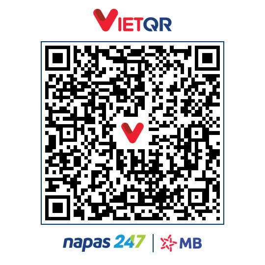
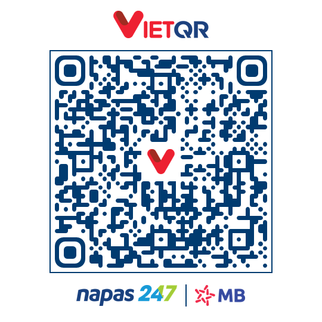
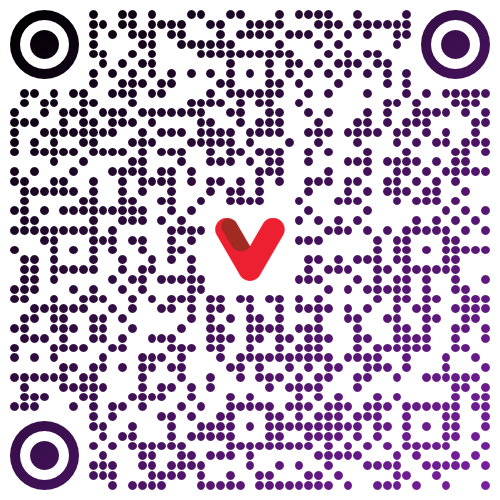
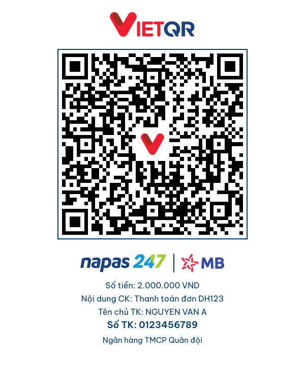

# vnqr-go 🇻🇳

[](https://pkg.go.dev/github.com/vuongtlt13/vnqr-go)

Thư viện Go tạo, đọc và vẽ mã QR thanh toán **VietQR** (chuẩn EMVCo / NAPAS247). Đây là bản Go của [vnqr](https://github.com/vuongtlt13/vnqr) (Python): cùng input thì ra cùng chuỗi VietQR.

## ✨ Tính năng

- ✅ Tạo chuỗi VietQR đầy đủ tuỳ chọn: QR tĩnh/động, chuyển đến tài khoản hoặc thẻ, số hoá đơn, mã tham chiếu, tên/thành phố đơn vị thụ hưởng
- ✅ Nhận ngân hàng theo **BIN, mã hoặc tên** (`"970422"`, `"MB"`, `"MBBank"`). Danh mục 76 ngân hàng đóng gói sẵn
- ✅ Tự bỏ dấu tiếng Việt ở các trường văn bản
- ✅ Giải mã chuỗi VietQR, kiểm tra CRC
- ✅ **Vẽ ảnh QR đẹp**: thẻ VietQR có logo VietQR, Napas247 và ngân hàng; mẫu in có thông tin chuyển khoản; module bo góc, chấm tròn, gradient, logo giữa, nền trong suốt
- ✅ Xuất **PNG / JPEG / SVG**, dạng bytes, base64 hoặc data URL
- ✅ Thuần Go, không cgo. Logo, font và danh mục ngân hàng nhúng bằng `go:embed`

<p align="center">
  
  
  
</p>

## 📦 Cài đặt

```bash
go get github.com/vuongtlt13/vnqr-go
```

Yêu cầu Go >= 1.25.

## 🚀 Sử dụng nhanh

```go
import vnqr "github.com/vuongtlt13/vnqr-go"

qr, err := vnqr.Build(vnqr.Payment{
    Bank:    "MB",                   // BIN "970422", mã "MB" hoặc tên "MBBank"
    Account: "0123456789",
    Amount:  2_000_000,              // 0 -> QR tĩnh, người chuyển tự nhập số tiền
    Content: "Thanh toán đơn DH123", // tự bỏ dấu: "Thanh toan don DH123"
})
if err != nil {
    return err
}

img, err := vnqr.Render(qr, &vnqr.RenderOptions{Template: vnqr.TemplateCompact})
if err != nil {
    return err
}
err = img.Save("vietqr.png") // thẻ VietQR 540x540
```

### Tạo chuỗi VietQR

```go
qr, err := vnqr.Build(vnqr.Payment{
    Bank:           "BIDV",
    Account:        "9704181234567890",
    Amount:         150_000,
    Content:        "Tiền điện tháng 10",
    Service:        vnqr.ServiceCard,    // ServiceAccount (QRIBFTTA, mặc định) | ServiceCard (QRIBFTTC)
    BillNumber:     "HD001",             // tag 62-01
    ReferenceLabel: "REF-9",             // tag 62-05
    MerchantName:   "Công ty Điện lực",  // tag 59 (tối đa 25 ký tự, viết hoa, bỏ dấu)
    MerchantCity:   "Hà Nội",            // tag 60 (tối đa 15 ký tự)
    Mode:           vnqr.ModeAuto,       // động nếu có số tiền / số HĐ / mã tham chiếu
    KeepDiacritics: false,               // true: giữ nguyên dấu
})
```

### Giải mã chuỗi VietQR

```go
info, err := vnqr.Parse(qr) // errors.Is(err, vnqr.ErrInvalidCRC / ErrInvalidTLV / ErrNotVietQR)
info.BankBIN, info.Account, info.Amount, info.Content
bank, ok := info.Bank()     // bank.ShortName == "BIDV"
info.Service                // vnqr.ServiceCard
vnqr.VerifyCRC(qr)          // true
vnqr.ParseLenient(qr)       // không bắt buộc CRC đúng, xem info.CRCValid
```

### Tra cứu ngân hàng

```go
vcb, ok := vnqr.FindBank("Vietcombank") // Bank{BIN: "970436", Code: "VCB", ...}
bin, err := vnqr.ResolveBIN("tcb")      // "970407"
len(vnqr.ListBanks())                   // 76
```

## 🎨 Vẽ ảnh QR

`vnqr.Render(content, opts)` trả về `*vnqr.Image` với `.RGBA` (`*image.RGBA`), `.Save(path)`, `.Bytes(format)`, `.Base64(format)`, `.DataURL(format)` và `.SVG()`. `opts = nil` dùng mặc định.

| Mẫu | Kích thước | Nội dung |
|-----|------------|----------|
| `TemplateQROnly` (mặc định) | `Size` x `Size` (500) | Mã QR + icon VietQR giữa. Xuất được SVG |
| `TemplateCompact` | 540 x 540 × `Scale` | Logo VietQR, khung, mã QR, Napas247 \| logo ngân hàng |
| `TemplatePrint` | 600 x ~750 × `Scale` | Như compact, thêm số tiền, nội dung, tên chủ TK, số TK, tên ngân hàng |

```go
// Thẻ in, đọc sẵn ngân hàng/số TK/số tiền/nội dung từ chuỗi QR
img, err := vnqr.Render(qr, &vnqr.RenderOptions{
    Template:    vnqr.TemplatePrint,
    Scale:       2,
    AccountName: "Nguyễn Văn A",
    Description: "Tiền điện tháng 10", // bản có dấu để hiển thị
    Bank:        "BIDV",               // ghi đè ngân hàng
    BankLogo:    myBankLogo,           // image.Image, mặc định dùng logo đóng gói
})

// Kiểu module
logo, _ := vnqr.LoadImageFile("logo.png")
img, err = vnqr.Render(qr, &vnqr.RenderOptions{
    Style: vnqr.Style{
        ModuleShape:     vnqr.ModuleRounded,  // ModuleSquare | ModuleRounded | ModuleCircle | ModuleGapped
        EyeShape:        vnqr.EyeRounded,     // EyeSquare | EyeRounded | EyeCircle (3 ô định vị)
        Color:           vnqr.MustHex("#003B70"),
        Gradient:        vnqr.GradientDiagonal, // Vertical | Horizontal | Diagonal | Radial
        GradientColor:   vnqr.MustHex("#7A1FA2"),
        EyeColor:        nil,                 // màu riêng cho ô định vị
        Transparent:     false,               // nền trong suốt (mẫu qr_only)
        ErrorCorrection: vnqr.ECQuartile,     // L | M | Q (mặc định) | H
    },
    CenterLogo:      logo,
    CenterLogoRatio: 0.2,
})

// Không logo giữa; xuất SVG vector
img, err = vnqr.Render(qr, &vnqr.RenderOptions{NoCenterLogo: true})
err = img.Save("qr.svg")

// Dùng trong HTML / API
url, err := img.DataURL(vnqr.FormatPNG) // data:image/png;base64,...
```

<p align="center">
  
</p>

> Đổi màu, đổi hình module hoặc chèn logo đều làm giảm độ tương phản và phần dữ liệu dư. Hãy giữ module màu đậm trên nền sáng, và **quét thử bằng app ngân hàng thật** trước khi phát hành.

## 💡 Ví dụ và công cụ

```bash
go run ./examples/styled    # xuất ảnh mẫu vào examples/styled/
go run ./cmd/crawl-banks    # cập nhật data/banks.json từ api.vietqr.io
```

## 🏦 Mã BIN của các ngân hàng phổ biến

Không cần nhớ BIN, có thể truyền mã hoặc tên ngân hàng. Tra đầy đủ bằng `ListBanks()`.

| Ngân hàng | Mã | BIN |
|-----------|----|-----|
| Vietcombank | VCB | 970436 |
| VietinBank | ICB | 970415 |
| BIDV | BIDV | 970418 |
| Agribank | VBA | 970405 |
| Techcombank | TCB | 970407 |
| MBBank | MB | 970422 |
| ACB | ACB | 970416 |
| VPBank | VPB | 970432 |
| TPBank | TPB | 970423 |
| ABBANK | ABB | 970425 |

## 🧪 Testing

```bash
go test ./...   # ảnh được giải mã lại bằng gozxing; chuỗi VietQR so với bản Python
go vet ./...
```

## 📄 License

Mã nguồn phát hành theo giấy phép MIT, xem [LICENSE](LICENSE). Font Be Vietnam Pro theo SIL OFL 1.1.

## ⚠️ Tuyên bố miễn trừ trách nhiệm

VietQR, NAPAS và NAPAS247 là nhãn hiệu của NAPAS. Logo ngân hàng thuộc về từng ngân hàng. Thư viện không có liên kết với các tổ chức này và không được họ bảo trợ. Phần mềm được cung cấp **nguyên bản (AS-IS)**; người triển khai chịu trách nhiệm về tính chính xác của thông tin thanh toán và về an toàn dữ liệu. Chi tiết: [DISCLAIMER.md](DISCLAIMER.md).

## 👤 Author

**Do Quoc Vuong**: vuongtlt13@gmail.com, [@vuongtlt13](https://github.com/vuongtlt13)

## 🙏 Acknowledgments

- NAPAS: tiêu chuẩn VietQR
- [vietqr-core](https://github.com/Ngochiendev/vietqr-core): bố cục ảnh thẻ VietQR
- [VietQR.io](https://www.vietqr.io): danh mục ngân hàng
- [go-qrcode](https://github.com/skip2/go-qrcode), [golang.org/x/image](https://pkg.go.dev/golang.org/x/image), [gozxing](https://github.com/makiuchi-d/gozxing)

---

Made with ❤️ in Vietnam
